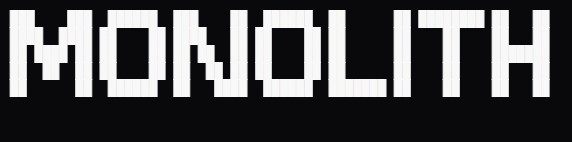

  

  

    An aesthetically crafted terminal theme for <a href="https://obsidian.md">Obsidian</a>. 
    Designed to channel the energy of hackers and cyberpunk interfaces—locking you into deep focus and uninterrupted productivity.
  

   

  

    
    &nbsp;
    
  

---

## Features

- **Pure OLED Black (`#000000`)**: Designed for true black OLED displays and high-contrast distraction-free note taking.
- **Strictly Monospaced**: 100% monospaced typography using **Iosevka** across all UI elements, editor, codeblocks, callouts, sidebars, and menus.
- **Square TUI Architecture**: Crisp `0px` border radii with square tabs, terminal headers, and seamless interface frames.
- **6 Built-in Color Schemes** (switchable via [Style Settings](https://github.com/mgmeyers/obsidian-style-settings)):
  - ⬛ **OLED** *(Default)*: Minimalist high-contrast monochrome black & white.
  - 🟨 **Kingsley**: Classic amber phosphor CRT terminal.
  - 🟪 **Cyberpunk**: High-tech neon cyber yellow (`#fcee0a`) & cyan (`#00f0ff`).
  - 🟥 **Arasaka**: Corporate crimson red (`#ff003c`) & sharp white.
  - 🟩 **Matrix**: Classic green CRT phosphor (`#33ff66`).
  - 🟦 **Cobalt**: Deep electric ice blue (`#38bdf8`).
- **Dynamic Callout Borders**: 4px left-border automatically matching each callout type's signature color with clean zero-margin spacing.
- **Clean Code Blocks**: High-readability solid background (`#131313`) with indentation lines hidden for a distraction-free editing experience.

---

## Gallery / Theme Previews

### OLED (Default Monochrome)

### Arasaka (Corporate Crimson)

### Matrix (Phosphor Green)

### Cobalt (Deep Electric Blue)

---

## Recommended Font

Monolith Terminal is designed specifically for **[Iosevka](https://typeof.net/Iosevka/)** / **[Iosevka Nerd Font](https://www.nerdfonts.com/)**.
Please make sure Iosevka is installed on your system for the intended terminal aesthetic.

---

## Configuration with Style Settings

1. Install the **Style Settings** community plugin in Obsidian.
2. Go to **Settings > Style Settings > Monolith Terminal**.
3. Under **Terminal Theme**, select your preferred color scheme (OLED, Kingsley, Cyberpunk, Arasaka, Matrix, or Cobalt).

---

## Installation

### From Obsidian Community Themes (Recommended)
1. Open **Settings > Appearance > Themes**.
2. Click **Explore** and search for **Monolith Terminal**.
3. Click **Install and use**.

### Manual Installation
1. Download `theme.css` and `manifest.json` from the latest release.
2. Create a folder named `Monolith Terminal` inside `<Vault>/.obsidian/themes/`.
3. Place `theme.css` and `manifest.json` inside that folder.
4. Activate the theme under **Settings > Appearance > Themes**.

---

## Credits & Attribution

**Monolith Terminal** is a maintained fork and modernized evolution of **[Diana's Obsidian Retro Terminal Theme](https://github.com/madebydia/obsidian-retro-terminal-theme)**.

### Original Work
- **Original Creator**: [Diana (@madebydia)](https://github.com/madebydia)
- **Original Repository**: [obsidian-retro-terminal-theme](https://github.com/madebydia/obsidian-retro-terminal-theme)
- **Original Concept**: Retro terminal aesthetic, monospaced typography, and CRT-inspired design system

### Changes in This Fork
This maintained version includes:
- Expansion to **6 color scheme variants** (OLED, Kingsley, Cyberpunk, Arasaka, Matrix, Cobalt)
- Enhanced **Style Settings integration** for easy theme customization
- Refined color palettes optimized for **OLED displays** and readability
- Improved **callout styling** and code block presentation
- Updated for **latest Obsidian API** compatibility
- Active maintenance and community support

Full credit and gratitude go to Diana for the original foundation, retro concept, and design inspiration that made this evolution possible.

---

## License

This project is licensed under the **[MIT License](LICENSE)**.

**Original work** © Diana  
**Modifications & additions** © 2026 davindakhrisna

Both the original and modified versions are freely available under the same MIT license terms. See [LICENSE](LICENSE) for details.
